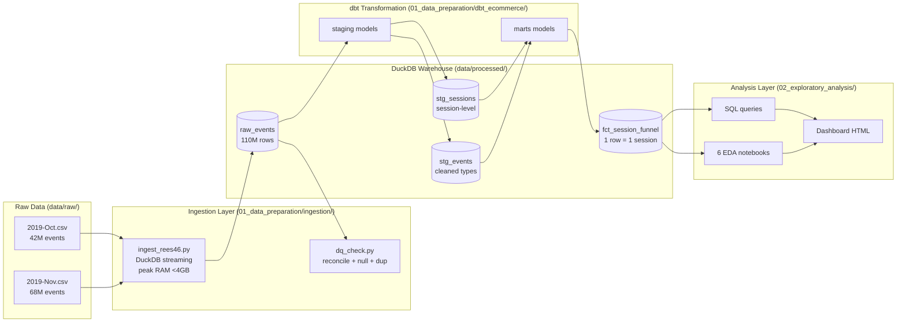
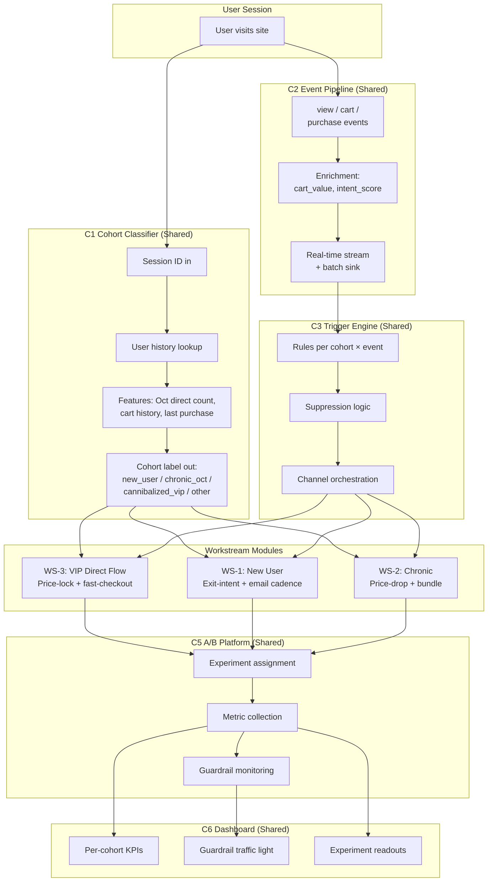
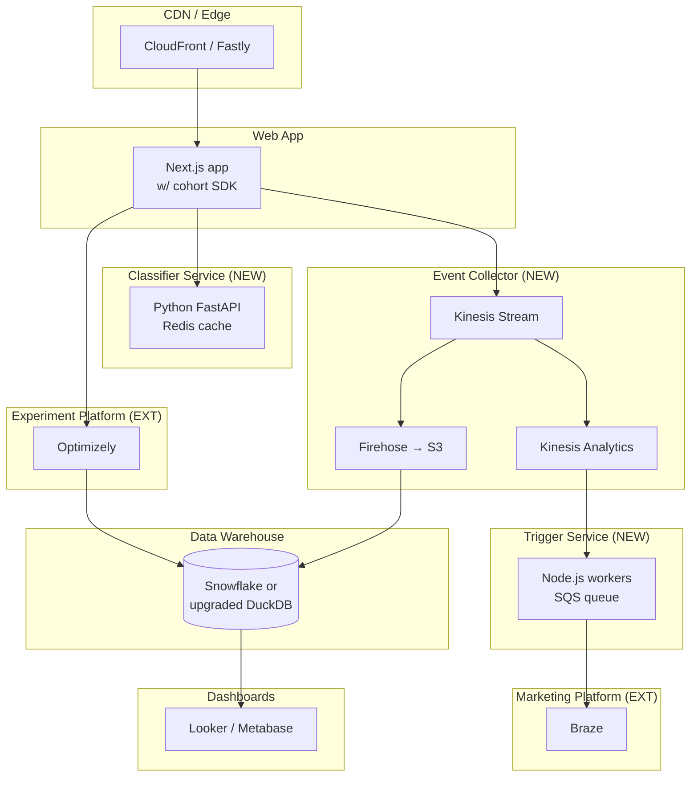

# Kiến Trúc Kỹ Thuật — BF Triple-Leak Protection

**Mục đích:** Sơ đồ kiến trúc hệ thống + luồng dữ liệu để CTO/VP Eng xem xét.
**Phạm vi:** Analytics pipeline (đã xây dựng) + Production system (kế hoạch)

---

## 1. Analytics Pipeline (Đã Xây Dựng)

### Quyết Định Thiết Kế
- **DuckDB thay vì Spark/BigQuery:** 110M rows phù hợp với single-node, zero infra cost, giao diện SQL
- **dbt thay vì raw SQL scripts:** Dependency DAG, testing, tài liệu tự động tạo
- **Phân vùng theo `event_month`:** Cho phép xử lý theo từng tháng để giữ dưới 4GB RAM
- **Materialization: `table` cho mart, `view` cho staging:** Hiệu suất truy vấn cho phân tích
- **Không dùng Pandas để ingest:** `pd.read_csv` không có chunksize crash ở 110M dòng; DuckDB native streaming hoạt động tốt

### Hiệu Năng
- Full ingest: ~15 phút
- Full dbt rebuild: ~8 phút
- Validation query (count + sum trên fct_session_funnel): <2 giây
- Peak RAM: 3.8GB

---

## 2. Production System (Kế Hoạch, Theo Master PRD)

### SLA
| Dịch Vụ | Latency SLA | Fallback |
|---|---|---|
| C1 Classifier | <50ms P95 | Mặc định bucket "other" |
| C2 Event pipeline | <5 phút batch, <1 giây stream | Buffered retry |
| C3 Trigger engine | <100ms mỗi quyết định | Bỏ qua trigger, log miss |
| C5 A/B framework | <10ms variant lookup | Mặc định về control |
| C6 Dashboard | 15 phút refresh | Giá trị cache cuối cùng |

---

## 3. Lựa Chọn Công Nghệ

### Analytics (Đã Xây Dựng)
| Thành Phần | Lựa Chọn | Thay Thế Đã Xem Xét | Lý Do |
|---|---|---|---|
| Warehouse | DuckDB | PostgreSQL, BigQuery | Zero infra, columnar, SQL |
| Transformation | dbt-core | Airflow + custom | Dependency DAG, testing |
| Processing | Python 3.11 + Polars | Pandas | Pandas crash ở 110M dòng |
| Visualization | HTML + inline SVG | React dashboard | Zero-dep, di động |

### Production (Kế Hoạch)
| Thành Phần | Lựa Chọn | Thay Thế | Lý Do |
|---|---|---|---|
| Classifier serving | Python microservice | Lambda | Hot path <50ms |
| Event stream | Kafka or Kinesis | SQS | Ordering + replay |
| Trigger storage | PostgreSQL | DynamoDB | Transactional + joins |
| Email automation | Braze or Klaviyo | In-house | Deliverability expertise |
| A/B platform | Optimizely or VWO | In-house | Time-to-market |
| Dashboard | Metabase or Looker | Custom React | Self-serve cho stakeholders |

---

## 4. Data Model (Tầng Mart)

### `fct_session_funnel` — Bảng phân tích chính

| Cột | Kiểu | Mô Tả |
|---|---|---|
| `user_session` | VARCHAR | Session UUID (PK) |
| `user_id` | BIGINT | Persistent user ID |
| `session_date` | DATE | Ngày event đầu tiên |
| `session_month` | DATE | Khóa phân vùng theo tháng |
| `first_event_time` | TIMESTAMP | Bắt đầu session |
| `last_event_time` | TIMESTAMP | Kết thúc session |
| `session_duration_min` | DOUBLE | Số phút hoạt động |
| `event_count` | INT | Tổng events trong session |
| `view_count` | INT | Events view |
| `cart_count` | INT | Events cart |
| `purchase_count` | INT | Events purchase |
| `has_view` | BOOLEAN | Có view xảy ra |
| `has_cart` | BOOLEAN | Có cart xảy ra |
| `has_purchase` | BOOLEAN | Có purchase xảy ra |
| `cart_value` | DECIMAL | SUM(price) của cart events |
| `purchase_value` | DECIMAL | SUM(price) của purchase events |
| `first_cart_time` | TIMESTAMP | Event cart đầu tiên |
| `first_purchase_time` | TIMESTAMP | Event purchase đầu tiên |
| `minutes_cart_to_purchase` | DOUBLE | Độ trễ quyết định |
| `is_abandoned` | BOOLEAN | Có cart nhưng không purchase |

### Indexes
- Primary: `(user_session)`
- Secondary: `(session_date)`, `(user_id)`, `(session_month)`

---

## 5. Kiến Trúc Triển Khai (Production)

---

## 6. Bảo Mật & Tuân Thủ

- **Xử lý PII:** `user_id` được hash trước khi đưa vào analytics warehouse
- **GDPR:** Marketing consent được ghi nhận + lưu trữ cùng hồ sơ user; pipeline xóa dữ liệu cho right-to-forget
- **Mã giảm giá:** Liên kết với user, dùng một lần, tạo bằng mật mã
- **Price-lock:** Chỉ phía server, user không thể thao túng client-side
- **Rate limits:** 10 price-locks/user/giờ (phòng bot)
- **Audit trail:** Mọi quyết định trigger được ghi log với cohort + rule ID

---

## 7. Khả Năng Mở Rộng

### Hiện Tại (Ước Tính BF Năm 1)
- Events hàng ngày: 2.5M (ngày đỉnh 10M trong BF)
- Phân loại hàng ngày: 500K
- Gửi email hàng ngày: 200K

### Tương Lai (Tăng Trưởng 3-5×)
- Events hàng ngày: 10-15M
- Cần: Chuyển xử lý stream sang Kinesis + Flink
- Nâng cấp data warehouse: DuckDB → Snowflake nếu sử dụng đa nhóm

### Đỉnh BF Cụ Thể
- Traffic đỉnh: 2-3× baseline hàng ngày trong 7 ngày
- Pre-warm: cấu hình autoscale 5× capacity 1 tuần trước BF
- Load test: 2× expected peak được xác nhận tại Tuần 15 của chương trình

---

## 8. Khả Năng Quan Sát

### Metrics (DataDog / Grafana)
- Classifier latency P50/P95/P99
- Event pipeline lag (giây)
- Tỷ lệ đánh giá trigger
- Thời gian phản hồi truy vấn dashboard

### Cảnh Báo (PagerDuty)
- Classifier P95 >100ms kéo dài 5 phút
- Event lag >10 phút
- Vi phạm guardrail metric kéo dài 3 giờ
- Bất thường variance A/B test

### Logs (Datadog Logs / CloudWatch)
- Mọi quyết định trigger (lấy mẫu 10%)
- Mọi cohort assignment
- Mọi variant assignment thử nghiệm
- Mọi lần dùng mã giảm giá

---

## 9. Tài Liệu Liên Quan

- Master PRD: `04_solution_design/prd/00_master_prd_triple_leak.md`
- Nguồn DE Pipeline: `01_data_preparation/ingestion/`
- dbt models: `01_data_preparation/dbt_ecommerce/models/`
- Data dictionary: `docs/data_dictionary.md`
