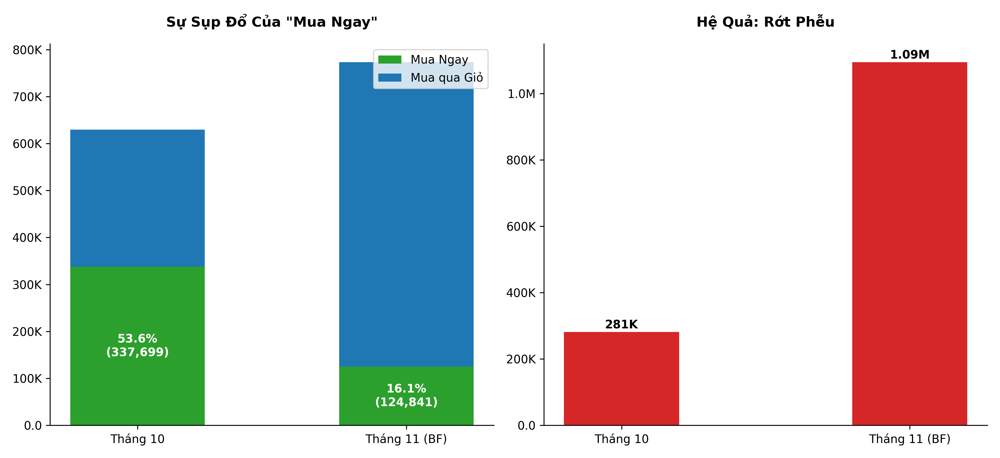
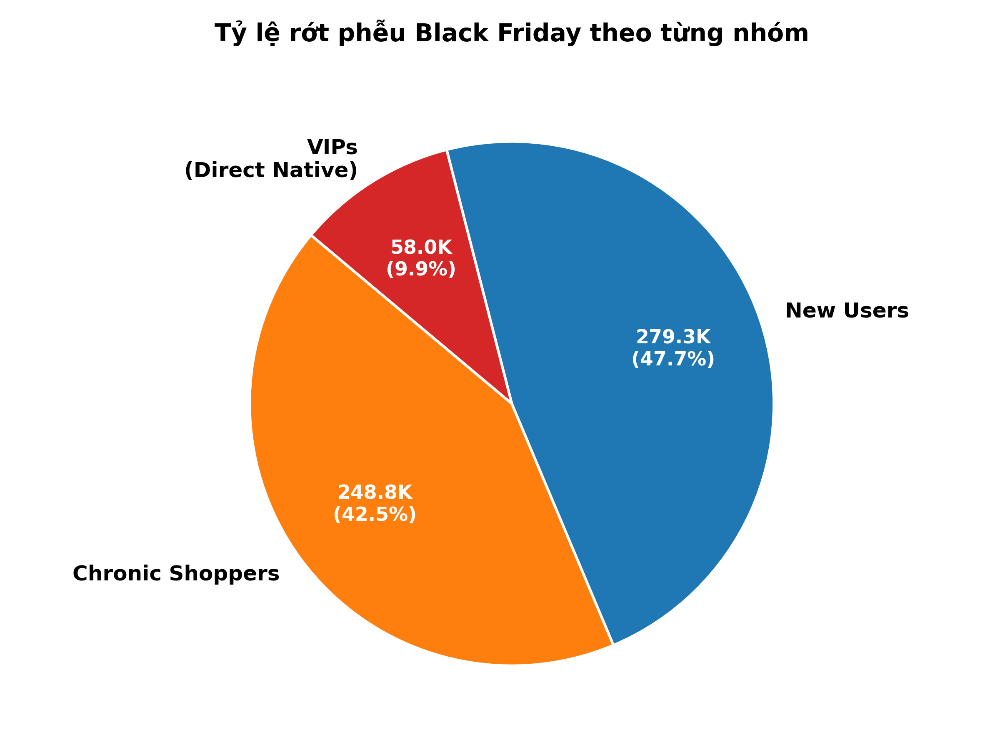
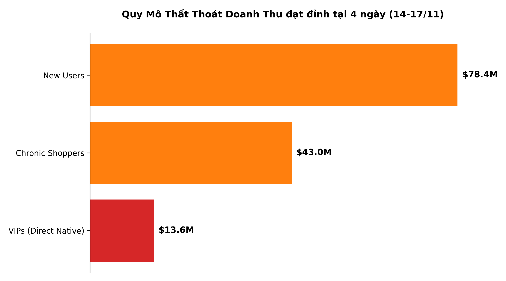

# Tối đa hóa doanh thu trong ngày Black Friday

---

## Vấn Đề 

Ngày Black Friday năm 2019 đã làm bốc hơi hơn $377M GMV tiềm năng của công ty. Nguyên nhân cốt lõi không đến từ lỗi kỹ thuật nền tảng, mà đến từ sự đứt gãy hành vi mua hàng của người dùng do cơ chế khuyến mãi/UI. 

Phân tích dữ liệu chia tệp khách hàng rớt phễu làm 3 nhóm chính:

**New Users:** Những tài khoản mới truy cập lần đầu.

**Chronic Shoppers:** Những người dùng chỉ lướt xem tháng 10, quay lại thêm đầy giỏ hàng tháng 11 nhưng không thanh toán.

**Nhóm khách hàng VIPs:** Tỷ lệ rớt phễu tăng vọt từ **0% (Tháng 10)** lên đến **55.6% (Tháng 11)**. Công ty mất **$13.6M** trực tiếp từ nhóm khách hàng này. Đây là tệp khách hàng vốn dĩ có ý định mua cực cao dù có giảm giá hay không.

**<mark>Giả định: việc phân tích chỉ dựa vào nguồn dữ liệu, không có giao diện người dùng thực tế vào thời điểm Black Friday. Nên giả định là giao diện UI vào Black Friday đang có những sự thay đổi khiến cho quy trình thao tác thanh toán thay đổi so với ngày thường</mark>**. 

Kết quả đánh giá cho thấy, nhóm khách hàng VIPs có tỷ lệ hủy thanh toán trong tháng 10 0 - 56% vào tháng 11. Với gần 58.000 hành vi hủy thanh toán khi đã thêm vào giỏ hàng của nhóm khách VIPs này. Đây có thể là dấu hiệu đứt gãy quá trình thao tác khi thêm các mã giảm giá trong ngày Black Friday.

---

## Nghiên cứu và phát hiện nguyên nhân
Dựa trên đánh giá của tập số liệu, bảng đánh giá cho thấy tháng 10 có lượt mua ngay với 337.699 (chiếm 53.6%) trong tổng số đơn thanh toán thành công. Sang Black Friday, số đơn trong giỏ hàng nhưng không được thanh toán lên tới gần 1.1 triệu tăng gần gấp 5 lần so với tháng 10. Song song đó, số đơn mua ngay rớt  xuống còn 124,841 đơn (**giảm ~ 72% so với tháng 10**) 

Mức độ ảnh hưởng của từng nhóm khách hàng lên tổng giá trị giao dịch:
| Cohort | Quy mô | GMV at Risk | Đặc Điểm Hành Vi |
|---|---|---|---|
| **New Users**  | 279K | **$78.4M** |  |
| **Chronic Shoppers**  | 248K | **$43.0M** | Tháng 10 không mua → tháng 11 có thêm giỏ hàng |
| **VIPs** (Rớt phễu do Funnel Cannibalization) | 58K | **$13.6M** | Rớt phễu: T10 (0%) → BF (55.6%) 
| | | **$135M (Chiếm 89% tổng GMV trong tháng 11)** |

  
  

 

---

## Giải pháp đề xuất

| Workstream | Chiến Lược | Phục Hồi Dự Kiến | Cơ Sở Tính Toán (Logic & Benchmark) |
|---|---|---|---|
| **New User** | Exit-intent + Phân luồng mã giảm giá bằng ML | **$7.8M** | **10% × 87.1M** (Ngưỡng benchmark E-commerce cứu vãn giỏ hàng cho KH mới) |
| **Chronic Shoppers** | Price-drop alerts + bundle cá nhân hóa + FOMO | **$6.5M** | **15% × 47.8M** (Tỷ lệ chuyển đổi tiêu chuẩn của chiến dịch Email Retargeting) |
| **VIP** | Trả lại nút Fast-checkout (Bypass giỏ hàng) + Banner suppression | **$12.2M** | **90% × 15.1M** (KH đã có ý định mua tuyệt đối, chỉ cần dỡ bỏ rào cản UI) |
| | **Tổng cộng mỗi sự kiện BF** | **$26.5M** |  |
